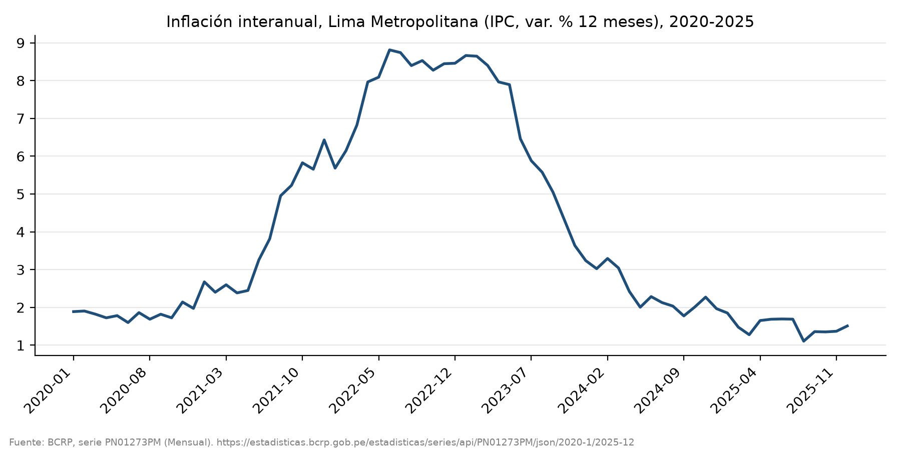
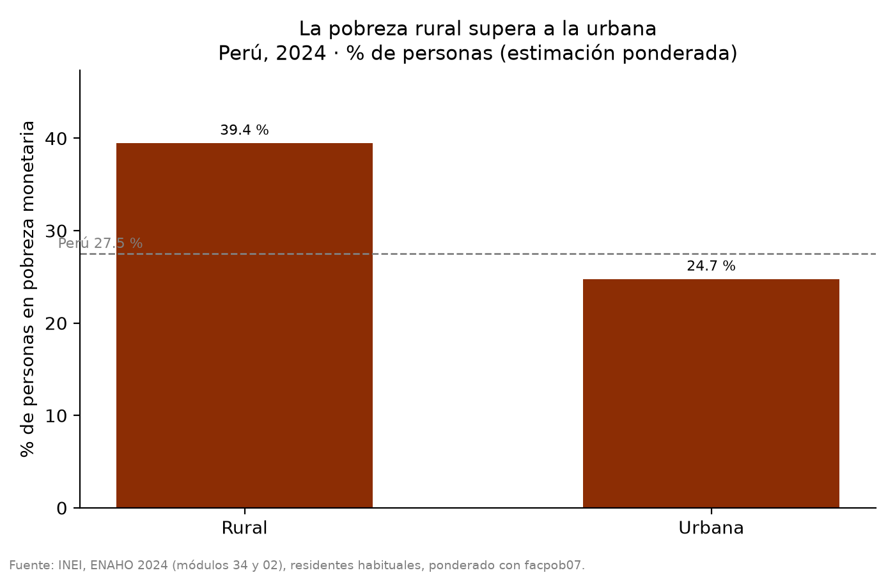
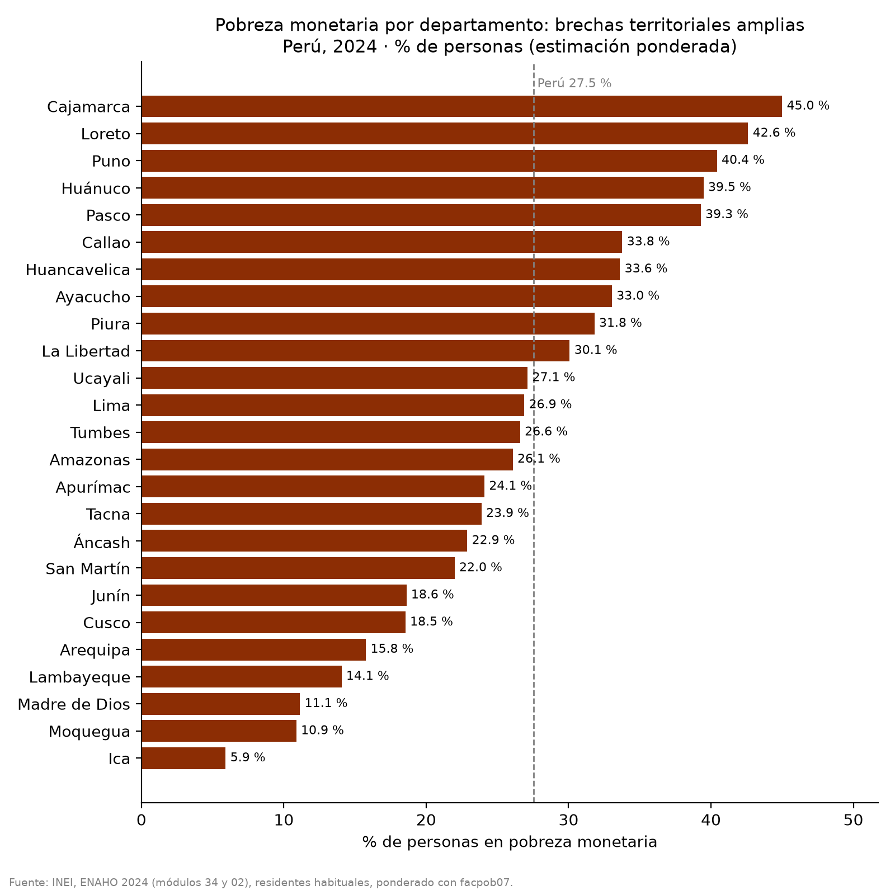
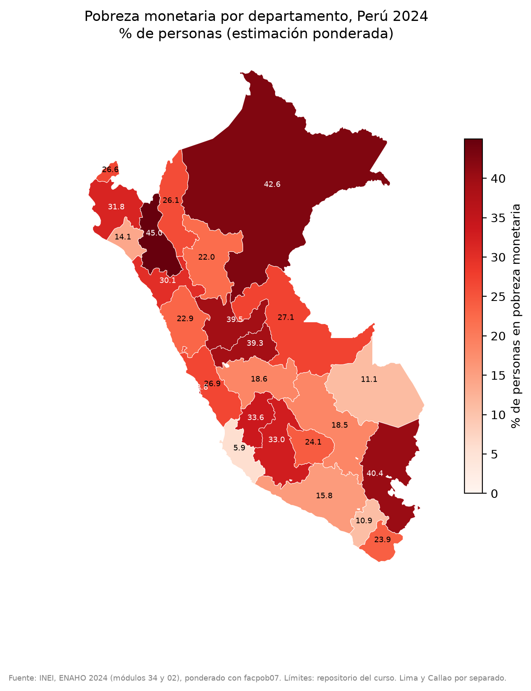

# Informe final: inflación en Lima Metropolitana (2020-2025) y pobreza monetaria en 2024

## 1. Pregunta de investigación

¿Cómo evolucionó la inflación de Lima Metropolitana entre 2020 y 2025, y qué diferencias territoriales (por departamento) y por área urbana/rural presentaba la pobreza monetaria en 2024?

## 2. Fuentes y metodología

- **BCRP (servidor MCP `bcrp`)**
  - `PN01273PM`: Índice de precios Lima Metropolitana, variación % 12 meses (IPC). Mensual, 2020-01 a 2025-12 (n = 72).
  - `PD04722MM`: Tasa de Referencia de la Política Monetaria. Mensual, mismo periodo (n = 72).
  - Herramientas: `buscar_series`, `resumen`, `correlacion` (Pearson), `serie` y `graficar_serie`. Todos los cálculos del BCRP salen de las herramientas.
- **INEI, ENAHO 2024**
  - Módulos 34 (sumaria) y 02 (miembros), unidos m:1. Residentes habituales: 108,664 personas.
  - Pobreza monetaria ponderada con `facpob07`. Área urbana/rural y departamento (25 unidades, con Lima y Callao separados).
  - Skills: `limpiando-enaho` (base ya procesada en `salidas/personas_2024.parquet`, validada 12/12), `graficando-enaho` (tipos `area` y `departamento`) y `mapeando-enaho`.

## 3. Resultados

**Hallazgo 1: la inflación subió hasta mediados de 2022 y luego volvió a niveles bajos.** La inflación interanual de Lima Metropolitana pasó de 1.89 % en 2020-01 a un máximo de 8.81 % en 2022-06. Su mínimo fue 1.11 % en 2025-08 y cerró en 1.51 % en 2025-12. El promedio 2020-01 a 2025-12 fue 3.97 %. (Serie PN01273PM, 2020-01 a 2025-12. Fuente: BCRP.)

**Hallazgo 2: la tasa de referencia siguió un ciclo parecido, con rezago y sin cerrar al mismo nivel.** La tasa pasó de 2.25 % en 2020-01 a un mínimo de 0.25 % en 2020-04 y a un máximo de 7.75 % en 2023-01. Cerró en 4.25 % en 2025-12 (promedio 4.12 %). La correlación de Pearson con la inflación 12 meses es r = 0.486 (n = 72). Es una asociación moderada, no una relación causal. (Series PN01273PM y PD04722MM, 2020-01 a 2025-12. Fuente: BCRP.)

**Hallazgo 3: la pobreza rural superó a la urbana por casi 15 puntos.** La pobreza monetaria nacional fue 27.53 %. En el área rural fue 39.44 % y en la urbana 24.74 %, una brecha de 14.70 pp (la tasa rural es 1.59 veces la urbana). (Fuente: INEI, ENAHO 2024, ponderado con facpob07.)

**Hallazgo 4: la dispersión departamental fue muy grande.** La pobreza más baja fue la de Ica (5.91 %) y la de Moquegua (10.88 %). Las más altas fueron Cajamarca (44.99 %) y Loreto (42.61 %). Lima fue 26.89 % y Callao 33.77 %. (Fuente: INEI, ENAHO 2024, ponderado con facpob07.)

## 4. Visualizaciones

## 5. Interpretación

La inflación limeña tuvo un episodio inflacionario acotado (2021-2023) con pico en 2022-06. En 2025 volvió a un rango bajo, con un mínimo de 1.11 %. La tasa de referencia subió durante ese episodio y se redujo después, lo que es coherente con la correlación positiva moderada. Esa correlación no identifica el efecto de la política monetaria sobre los precios.

La pobreza de 2024 se concentra en el área rural y en departamentos de sierra norte y selva (Cajamarca, Loreto, Huánuco, Puno, Pasco). Los departamentos costeros del sur (Ica, Moquegua, Arequipa) presentan las tasas más bajas. Estas diferencias territoriales son descriptivas.

## 6. Limitaciones

- **Periodos distintos:** la inflación cubre 2020-2025 (mensual) y la pobreza solo 2024 (una encuesta anual). No se puede relacionar la evolución de la inflación con la de la pobreza.
- **Niveles de agregación distintos:** el IPC es de Lima Metropolitana, mientras que la ENAHO se presenta a nivel nacional, por área y por departamento. El departamento de Lima (26.89 %) no equivale a Lima Metropolitana, y la inflación limeña no describe los precios en otras regiones.
- **Asociación ≠ causalidad:** r = 0.486 entre inflación y tasa de referencia es descriptiva; la política monetaria responde a la inflación y a otros factores, y viceversa.
- **Error muestral:** las estimaciones de ENAHO son de una muestra y tienen error, que es mayor en departamentos con menos observaciones (p. ej. Moquegua: n = 2,511; Madre de Dios: n = 2,045). No se calcularon intervalos de confianza. Contra la referencia oficial, las diferencias por departamento llegan a 0.5 pp (Huánuco y Puno).
- **Pobreza 2024 vs. inflación hasta 2025:** la ventana de inflación termina un año después de la encuesta.

## 7. Verificación

| # | Afirmación | Valor calculado | Procedimiento de verificación | Referencia | ¿Coincide? |
|---|---|---|---|---|---|
| 1 | Máximo de inflación 12 m, Lima: 8.81 % en 2022-06 | 8.8126 % (2022-06) | `resumen` PN01273PM 2020-01 a 2025-12, contrastado con `serie` 2022-04 a 2022-08 (la máxima de esos meses es 2022-06; los vecinos son 8.09 y 8.74) | BCRP, PN01273PM | Sí |
| 2 | Correlación inflación vs. tasa de referencia: r = 0.486 | 0.4861 (n = 72, sin periodos descartados) | `correlacion` PN01273PM y PD04722MM, 2020-01 a 2025-12 | BCRP, PN01273PM y PD04722MM | Sí (una sola corrida; no se recalculó por separado) |
| 3 | Pobreza nacional 2024: 27.5 % | 27.53 % | Recálculo independiente: Σ(pobre·facpob07)/Σ(facpob07) sobre `personas_2024.parquet` | INEI, cifra oficial 27.6 % (tolerancia ≤ 0.1 pp) | Sí (diferencia 0.07 pp) |
| 4 | Pobreza rural 39.44 % y urbana 24.74 % | 39.44 % y 24.74 % | Mismo recálculo ponderado por `area` | INEI, referencia informativa 39.3 % / 24.8 % | Sí, con diferencias de 0.14 y 0.06 pp |
| 5 | Pobreza departamental: Ica 5.91 %, Cajamarca 44.99 % | 5.91 % y 44.99 % | Recálculo ponderado por `departamento` (códigos 11 y 06) | Referencia del mapa: Ica 6.0 %, Cajamarca 45.0 % | Sí (≤ 0.1 pp) |

## 8. Reproducibilidad

- **Servidor MCP:** `mcp/server.py` (declarado en `.mcp.json`). Códigos de serie: `PN01273PM` (IPC Lima, var. % 12 meses) y `PD04722MM` (tasa de referencia).
- **Llamadas MCP:** `buscar_series("ipc lima 12 meses")`, `buscar_series("tasa de referencia")`, `resumen` (ambas series, 2020-01 a 2025-12), `correlacion(PN01273PM, PD04722MM, 2020-01, 2025-12)`, `graficar_serie(PN01273PM, 2020-01, 2025-12)` y `serie(PN01273PM, 2022-04, 2022-08)`.
- **Skills ENAHO (`.claude/skills/`):**
  - `uv run .claude/skills/graficando-enaho/scripts/graficar.py --tipo area`
  - `uv run .claude/skills/graficando-enaho/scripts/graficar.py --tipo departamento`
  - `uv run .claude/skills/mapeando-enaho/scripts/mapear.py`
  - `limpiando-enaho/scripts/limpiar.py` no se ejecutó, porque `salidas/personas_2024.parquet` ya existía (validación previa 12/12 en `salidas/validacion.txt`).
- **Datos de entrada:** `datos/966-Modulo34.zip`, `datos/966-Modulo02.zip` y `datos/peru_departamental_simple.geojson`.
- **Archivos generados:** `figuras/bcrp_PN01273PM.png`, `figuras/pobreza_area.png`, `figuras/pobreza_departamento.png`, `mapas/pobreza_departamento.png`, `salidas/pobreza_departamento.csv`, `salidas/comparacion_mapa.csv` y `salidas/indicadores.csv`.
- **Verificación independiente ENAHO:** `uv run python -I -c` con pandas sobre `salidas/personas_2024.parquet`, usando `pobre` y `facpob07`.
